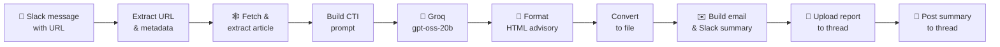

<div align="center">

# 🛡️ ThreatScribe

**Drop a security news link in Slack. Get a client-ready threat advisory back in under a minute.**


</div>

---

## Why

Writing a threat advisory by hand means reading the article, looking up the CVE, scoring it, writing detections and recommendations, then formatting it all for clients. That takes hours. ThreatScribe drafts all of it from a single URL, so analysts only need to review and send.

## Features

| | Feature | Detail |
|---|---|---|
| 🔗 | **One-link trigger** | Post any article URL in a Slack channel, nothing else needed |
| 🕸️ | **Resilient scraper** | Handles redirects, slug typos, bot/CAPTCHA walls, `<article>` → `<main>` → full-page → meta fallbacks |
| 🤖 | **Structured AI analysis** | 8-section CTI prompt with banned filler words, CVSS→severity mapping, "never invent facts" rules |
| 📊 | **Auto metadata** | Extracts severity, CVSS and CVEs, falling back to deriving severity from the CVSS score |
| 📄 | **4-page HTML report** | Cover page, metadata table, styled tables, severity badges, confidentiality footer |
| 🎯 | **IOC-aware layout** | IOC section and defanging notice appear only when indicators are found |
| ✉️ | **Email + Slack summary** | HTML email body and plain-text Slack summary generated alongside the report |
| 🧵 | **Thread replies** | Report and summary land in the same Slack thread as the original link |

## How it works



| # | Node | What it does |
|---|------|--------------|
| 1 | Slack Trigger | Listens for messages in the advisory channel |
| 2 | Extract URL & Metadata | Pulls the first URL, channel, thread and user |
| 3 | Fetch & Extract Content | Scrapes and cleans the article (max 12k chars) |
| 4 | Build AI Prompt | Builds the 8-section prompt and advisory ID `TADV-DDMMYYYY` |
| 5 | Prepare Groq Request | Packages the chat-completion request (temp 0.2, 4k tokens) |
| 6 | Groq AI Analyzer | Calls the Groq OpenAI-compatible API |
| 7 | Format HTML Advisory | Parses the Markdown sections into the styled report |
| 8 | Convert to Binary | Encodes the HTML as a file |
| 9 | Build Email Template | Generates the email HTML and the Slack summary |
| 10 | Upload Advisory to Slack | Uploads the `.html` report to the thread |
| 11 | Send Advisory Message | Posts the summary text to the thread |

## Advisory structure

| § | Section | Contents |
|---|---------|----------|
| 1 | Executive Summary | What it is, how it's exploited, business risk |
| 2 | Threat Overview | Identifier, type, actor, motivation, discovery, exploitation status |
| 3 | Technical Details | Attack vector, CWE, exploitation chain, impact, vendor fix |
| 4 | Affected Systems | Component / version / remediation table, enterprise exposure |
| 5 | Recommendations | Immediate (24h), medium-term (1–2w), long-term |
| 6 | MSSP Detection & Response | SIEM / EDR / IDS coverage, automated and manual response |
| 7 | IOCs | Shown only when indicators are found in the source |
| 8 | References | Original article, vendor advisory, NVD entry |

## Quick start

### Prerequisites

- n8n (self-hosted or cloud) with the Code node enabled
- A Slack app/bot added to your advisory channel
- A [Groq API key](https://console.groq.com/keys)

### 1. Import

In n8n: **Workflows → Import from File** → `threatscribe-workflow.json`

### 2. Credentials

| Credential | Required scopes / settings | Used by |
|---|---|---|
| Slack API | `channels:history`, `chat:write`, `files:write`, Event Subscriptions → `message.channels` | Slack Trigger, Upload, Send Message |
| Groq API | API key | Groq AI Analyzer |

### 3. Placeholders

| Placeholder | Node | Replace with |
|---|---|---|
| `YOUR_SLACK_CHANNEL_ID` | Slack Trigger, Upload Advisory to Slack | Channel ID (e.g. `C0XXXXXXXXX`) |
| `your-advisory-channel` | Slack Trigger, Send Advisory Message | Channel name |
| `REPLACE_WITH_YOUR_BASE64_PNG_LOGO` | Format HTML Advisory | `base64 -w0 logo.png` output |
| `YourOrg` / `yourorg` | Build AI Prompt, Format HTML, Build Email | Your organisation name |

### 4. Run

Activate the workflow, then post a link in the channel:

```
https://www.example-security-news.com/article/critical-rce-in-some-product
```

Within about 30–60 seconds, the bot replies in the thread with the `.html` advisory and a summary.

## Customising

| Want to… | Change |
|---|---|
| Use a different model | `model` in **Prepare Groq Request** (any Groq / OpenAI-compatible model) |
| Fix sites with ID-based URLs | Add a pattern to `canonicalize()` in **Fetch & Extract Content** |
| Change report branding | `CSS` and `LOGO_HTML` in **Format HTML Advisory** |
| Send by email | Add a Gmail / SMTP node after **Build Email Template** using `email_subject` and `email_body` |
| Add or remove sections | Edit the prompt in **Build AI Prompt** *and* the matching `extractSection()` calls |

## Known limitations

- **Review before sending.** Estimated CVSS scores (`~X.X (estimated)`), IOCs and references are AI-generated and must be checked by an analyst.
- **JavaScript-rendered or paywalled pages** may fail to scrape. The workflow raises a clear error instead of producing a bad report.
- **One advisory per day per ID.** The advisory ID is date-based, so two advisories on the same day share an ID.
- **The References section** in the prompt contains a fixed vendor link example. Adjust it for your typical sources.
- **Only the first 2,000 characters** of the article are sent to the model, to stay within token limits.

## Roadmap

- [ ] Unique advisory IDs (date + sequence)
- [ ] PDF export alongside HTML
- [ ] NVD API lookup to replace estimated CVSS with official scores
- [ ] Optional email delivery node

## Security

All credentials, webhook IDs, channel IDs, instance IDs and branding in this export have been **redacted**. Never commit a live n8n export: credential references and webhook IDs identify your instance.

